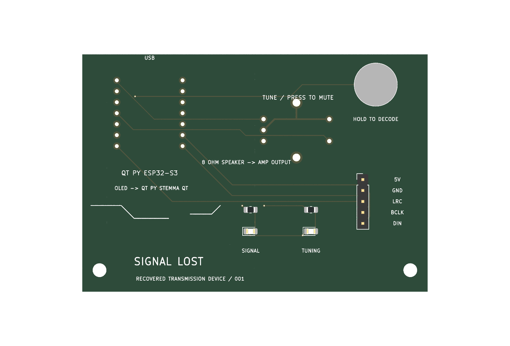
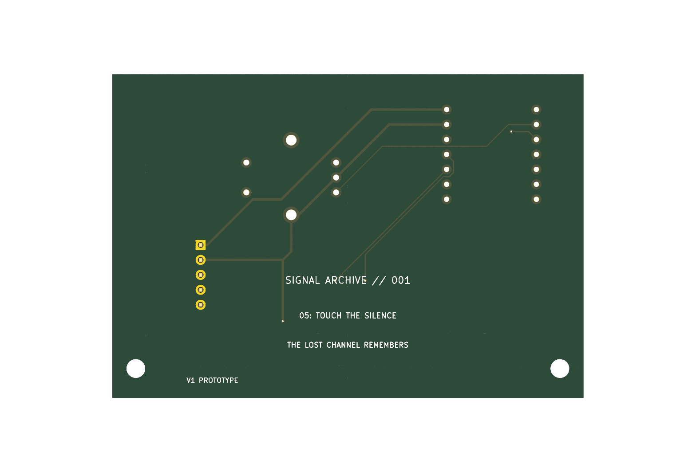
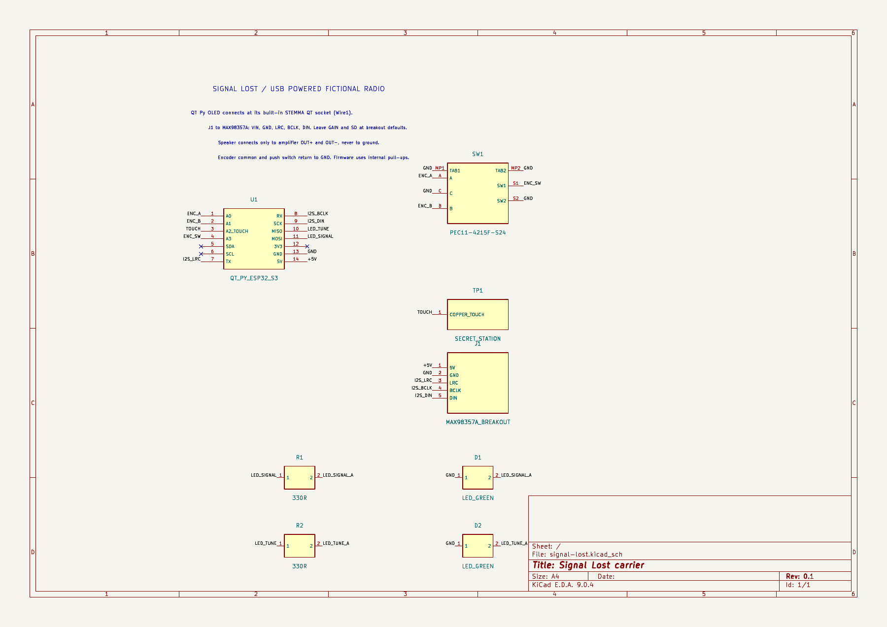

# Signal Lost

**An interactive PCB radio for fictional transmissions.** Turn a dial to explore strange stations, watch the signal indicators, and find a hidden touch pad that unlocks a secret channel.

The goal is a small, tactile storytelling device that feels like recovered radio equipment: the interaction comes from tuning, light, sound, and clues printed on the board. The displayed frequencies and sounds are fictional; the device does not receive broadcast radio.

## How it works

An **Adafruit QT Py ESP32-S3** sits on a custom **80 × 55 mm, two-layer carrier PCB**. A rotary encoder selects four ordinary stations: Night Weather, Distress, Numbers, and Deep Space. Pressing the dial toggles audio playback. The exposed copper touch pad selects the hidden Unknown station, and two LEDs show tuning and signal activity.

The firmware synthesizes tones, pulses, drones, and static at 16 kHz. A five-signal header carries power and I2S audio to an external **MAX98357A amplifier**; an **8 Ω, 1 W speaker** connects to the amplifier output. An external **128 × 32 OLED** uses the QT Py's STEMMA QT socket to display the station name and fictional frequency.

[Open the schematic PDF](docs/schematic.pdf) · [View the editable PCB on KiCanvas](https://kicanvas.org/?repo=https://github.com/yonathan-star/signal-lost/tree/main/PCB)

## Start here

1. **Electronics:** open [`PCB/signal-lost.kicad_pro`](PCB/signal-lost.kicad_pro) in KiCad 9. The schematic, board, custom symbol library, footprint library, and library tables live together in `PCB/`. Keep that folder intact so `${KIPRJMOD}` resolves the local libraries.
2. **Firmware:** open [`firmware/`](firmware/) in PlatformIO. From that folder, run `pio run -e qtpy_esp32s3` to build for the QT Py ESP32-S3 **4 MB flash / 2 MB PSRAM** variant. Dependencies are listed in [`platformio.ini`](firmware/platformio.ini).
3. **Assembly:** follow the pin map and wiring notes in [`docs/DESIGN_NOTES.md`](docs/DESIGN_NOTES.md). Use individual jumper leads for the amplifier because its breakout pins are not in carrier-header order. Connect the speaker only across amplifier OUT+ and OUT−. Start with low volume.
4. **Manufacturing:** use [`fabrication/signal-lost-gerbers.zip`](fabrication/signal-lost-gerbers.zip). Check the purchased encoder pin pattern against the custom footprint before ordering.

## Repository map

| Folder or file | Contents |
| --- | --- |
| [`PCB/`](PCB/) | Editable KiCad project, schematic, PCB, custom symbols/footprints, and local library tables |
| [`firmware/`](firmware/) | Arduino/PlatformIO source and build configuration |
| [`fabrication/`](fabrication/) | Gerbers, drill files, fabrication ZIP, and complete design-package ZIP |
| [`images/`](images/) | PCB renders and schematic images |
| [`docs/`](docs/) | Assembly/design notes, schematic PDF, and existing ERC/DRC reports |
| [`bom-signal-lost.csv`](bom-signal-lost.csv) | Component and PCB-fabrication list in CSV format |
| [`BOM.md`](BOM.md) | Parts/funding record mirrored from Half Life |
| [`JOURNAL.md`](JOURNAL.md), [`journal-evidence/`](journal-evidence/) | Design journal and its supporting images |

## Bill of materials

The amounts below reproduce the recorded submission BOM; they are **not fresh checkout quotes**. Open the buying links to confirm current price, stock, shipping, and taxes.

| Part / material | Qty | Unit USD | Total USD | Buying link |
| --- | ---: | ---: | ---: | --- |
| Adafruit QT Py ESP32-S3 4MB/2MB PSRAM #5700 | 1 | $12.50 | $12.50 | [DigiKey](https://www.digikey.com/en/products/detail/adafruit-industries-llc/5700/21283799) |
| Adafruit MAX98357A I2S amp breakout #3006 | 1 | $5.95 | $5.95 | [DigiKey](https://www.digikey.com/en/products/detail/adafruit-industries-llc/3006/6058477) |
| Adafruit 0.91 inch 128x32 STEMMA QT OLED #4440 | 1 | $12.50 | $12.50 | [DigiKey](https://www.digikey.com/en/products/detail/adafruit-industries-llc/4440/10824271) |
| Adafruit/Bourns rotary encoder with push switch and knob #377 | 1 | $4.50 | $4.50 | [DigiKey](https://www.digikey.com/en/products/detail/adafruit-industries-llc/377/7902287) |
| Same Sky CMS-30204-18L250 8 ohm 1 watt speaker | 1 | $2.74 | $2.74 | [DigiKey](https://www.digikey.com/en/products/detail/same-sky-formerly-cui-devices/CMS-30204-18L250/24398508) |
| Adafruit STEMMA QT/Qwiic 50mm cable #4399 | 1 | $0.95 | $0.95 | [DigiKey](https://www.digikey.com/en/products/detail/adafruit-industries-llc/4399/10824268) |
| Adafruit male break-away header pack #392 | 1 | $4.95 | $4.95 | [DigiKey](https://www.digikey.com/en/products/detail/adafruit-industries-llc/392/21283800) |
| Adafruit female-female 6-inch jumper wire pack #1950 | 1 | $1.95 | $1.95 | [DigiKey](https://www.digikey.com/en/products/detail/adafruit-industries-llc/1950/6827084) |
| Yageo RC0805FR-10330RL 330 ohm 0805 resistor | 2 | $0.10 | $0.20 | [DigiKey](https://www.digikey.com/en/products/detail/yageo/RC0805FR-10330RL/13694160) |
| Lite-On LTST-C170GKT green 0805 LED | 2 | $0.17 | $0.34 | [DigiKey](https://www.digikey.com/en/products/detail/liteon/LTST-C170GKT/269226) |
| 5-board batch: 80 x 55 mm 2-layer FR-4 lead-free HASL | 1 | $5.20 | $5.20 | [JLCPCB](https://cart.jlcpcb.com/quote) |

**Recorded parts and PCB subtotal: $51.78.** The submission's tax/shipping estimate is **$16.01**, for an estimated **$67.79 total**. Tier 2 funding is $65, leaving a recorded $2.79 difference. A USB cable and future enclosure are not included in that subtotal. The source CSV and mirrored BOM retain the detailed notes.

## Current design status

The existing verification reports record **zero schematic ERC errors or warnings**, **zero PCB DRC errors**, and **zero unconnected pads**, with one front-silkscreen warning at the exposed touch pad. The firmware was previously compiled for the configured QT Py target. See [`docs/verification/`](docs/verification/).

This is a **Design Week submission**. The hardware has not been assembled or physically tested. The current design includes the carrier PCB and external modules; the enclosure, display/speaker mounts, and illuminated cutouts remain future work. First-build checks include touch calibration, encoder direction, OLED address, audio level, connector clearance, and the exact purchased encoder footprint.
